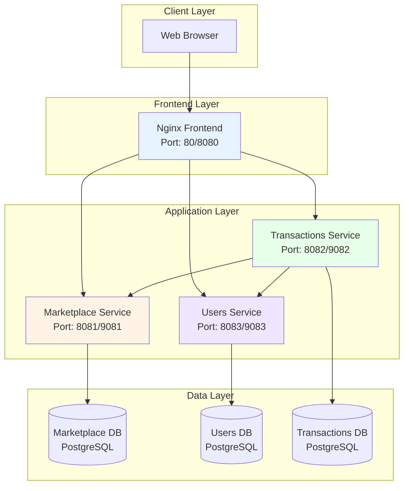
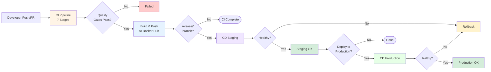
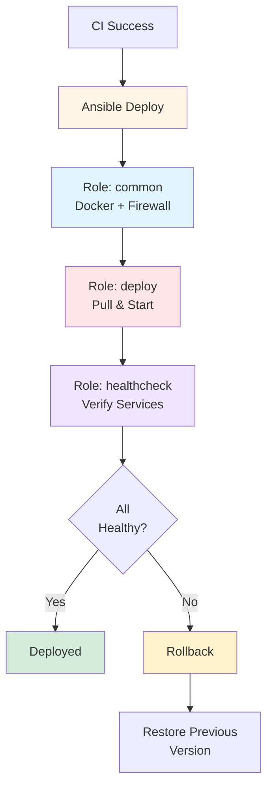

# EcoCycle DevOps Project — CI/CD Pipeline & Infrastructure Automation

[](https://github.ncsu.edu/mdshah5/ecocycle-project/actions)
[](#security-implementation)
[](https://hub.docker.com/u/manavshah13)

**Team Members:** Manav Shah (mdshah5) | Yuvraj Singh Bhatia (ybhatia2)  


## 📋 Table of Contents

- [Overview](#overview)
- [Architecture](#architecture)
- [CI/CD Pipeline](#cicd-pipeline)
  - [CI Pipeline (7 Stages)](#ci-pipeline-7-stages)
  - [CD Pipeline (Staging & Production)](#cd-pipeline-staging--production)
- [Infrastructure as Code](#infrastructure-as-code)
- [Microservices](#microservices)
- [Security Implementation](#security-implementation)
- [Setup & Deployment](#setup--deployment)
- [Testing & Quality Gates](#testing--quality-gates)
- [Monitoring & Health Checks](#monitoring--health-checks)
- [Troubleshooting](#troubleshooting)
- [Documentation](#documentation)
- [Learning Resources](#learning-resources)
- [Team Contributions](#team-contributions)
- [License & Contact](#license--contact)
- [Quick Start Summary](#quick-start-summary)


## <a id="overview"></a>Overview

EcoCycle is a **sustainability-focused marketplace platform** with three Spring Boot microservices (Marketplace, Transactions, Users) and an Nginx-based frontend. This project implements a **production-ready CI/CD pipeline** using GitHub Actions and Ansible that automates:

- **Continuous Integration**: Code quality checks, testing, security scanning, and Docker builds
- **Continuous Deployment**: Automated staging and production deployments with health verification
- **Security Hardening**: 12+ security features including vulnerability scanning, non-root containers, and secrets management
- **Infrastructure as Code**: Ansible-based deployment automation with rollback capabilities
- **Self-Hosted Runner**: Persistent build cache and full control over CI environment

### Key Achievements

- **Automation**: Reduced deployment time from 2+ hours (manual) to 15 minutes (automated)
- **Quality Gates**: 7-stage CI pipeline with Checkstyle, JUnit, JaCoCo (50%+ coverage), SpotBugs, OWASP, Hadolint, Trivy
- **Security**: Multi-layer vulnerability scanning, non-root containers, encrypted secrets, firewall rules
- **Reliability**: Automated health checks with rollback on failure
- **Reproducibility**: Complete Infrastructure as Code with Ansible

---

## <a id="architecture"></a>Architecture



### Deployment Environments

| Environment | Host | Ports | Purpose |
|------------|------|-------|---------|
| **Staging** | 152.7.176.20 | Frontend: 80, Services: 8081-8083 | Pre-production testing |
| **Production** | 152.7.176.20 | Frontend: 8080, Services: 9081-9083 | Production deployment |

---

## <a id="cicd-pipeline"></a>CI/CD Pipeline Flow



---

## <a id="ci-pipeline-7-stages"></a>🔧 CI Pipeline (7 Stages)

### Triggers
```yaml
# PRs to main/release/develop branches
pull_request:
  branches: ['main', 'release/**', 'develop']

# Direct pushes to protected branches
push:
  branches: ['main', 'release/staging', 'release/production']
```

1. **Validation** - Checks project structure and caches Maven dependencies (~80% faster builds)
2. **Code Quality** - Checkstyle enforces Google Java Style Guide
3. **Unit Tests & Coverage** - JUnit tests with JaCoCo enforcing 50%+ coverage
4. **Static Analysis** - SpotBugs detects bug patterns (informational, doesn't fail build)
5. **Security Scanning** - Three layers:
   - Hadolint scans Dockerfiles for security best practices
   - OWASP Dependency Check scans Maven dependencies (fails on CVSS ≥ 7)
   - Trivy scans Docker images for vulnerabilities (fails on CRITICAL/HIGH)
6. **Build Docker Images** - Multi-stage builds, pushes to Docker Hub with tags (latest, pr-#, sha-, branch)
7. **Build Summary** - Aggregates results and fails on critical issues


---

## <a id="cd-pipeline-staging--production"></a>CD Pipeline (Staging & Production)




### Staging Deployment

**Trigger:**
```yaml
workflow_run:
  workflows: ["CI Pipeline"]
  types: [completed]
  branches: ['release/staging']

# Only run if CI succeeded
if: github.event.workflow_run.conclusion == 'success'
```

### Production Deployment

**Trigger:**
```yaml
workflow_run:
  workflows: ["CI Pipeline"]
  types: [completed]
  branches: ['main', 'release/production']
```

### Deployment Process
1. Configure SSH using GitHub secrets.
2. Install Ansible and test connection.
3. Run Ansible playbook (common role → deploy role → healthcheck role).
4. Verify all services are healthy.
5. Rollback if any service fails health checks.


## <a id="infrastructure-as-code"></a>Infrastructure as Code

All deployment is automated with Ansible. We have three roles:

1. **Common Role** - Sets up the VM (Docker, firewall, directories, log rotation).
2. **Deploy Role** - Pulls images from Docker Hub and deploys with Docker Compose.
3. **Healthcheck Role** - Verifies all services are healthy (retries up to 15 times).

Playbooks are in `ansible/playbooks/` and roles are in `ansible/roles/`. Secrets are encrypted with Ansible Vault (AES256).

## <a id="microservices"></a>Microservices

**Marketplace Service** - Handles listings (donations/sales). Endpoints: POST/GET/DELETE `/api/listings`

**Users Service** - User management and authentication. Endpoints: POST `/api/auth/register`, POST `/api/auth/login`, CRUD operations on `/api/users`

**Transactions Service** - Handles transactions between users. Communicates with Marketplace and Users services via HTTP. Endpoints: POST `/api/transactions/offers`, POST `/api/transactions/claim`, GET/PUT on `/api/transactions`

**Frontend** - Nginx reverse proxy serving static HTML/JS/CSS and proxying API calls to backend services

All services use Spring Boot Actuator for health checks at `/actuator/health`.

## <a id="security-implementation"></a>Security Implementation

### 1. Vulnerability Scanning (3 Layers)

#### Layer 1: OWASP Dependency Check
- **What:** Scans Maven dependencies against NVD (50,000+ CVEs)
- **Where:** `.github/workflows/ci.yml`, `pom.xml`
- **Threshold:** CVSS ≥ 7 fails build
- **Example:** Detected outdated Spring Boot with CVE-2023-20883 → upgraded to 3.5.6

#### Layer 2: Hadolint Dockerfile Linting
- **What:** Static analysis of Dockerfiles for security best practices
- **Where:** `.github/workflows/ci.yml`
- **Checks:** Pinned versions, non-root user, minimal layers, no secrets in ENV
- **Example:** Enforced `USER ecocycle` in all service Dockerfiles

#### Layer 3: Trivy Image Scanning
- **What:** Scans Docker images for OS/library vulnerabilities
- **Where:** `.github/workflows/ci.yml`
- **Severity:** CRITICAL + HIGH (exit-code: 1)
- **Example:** Caught vulnerable OpenSSL in base image → switched to patched image

### 2. Container Hardening

- **Why:** Limits blast radius if container compromised
- **Impact:** Attacker has no root privileges even if shell access gained

#### Multi-Stage Builds
- **Why:** Excludes build tools from runtime (60% smaller: 800MB → 300MB)
- **Impact:** Fewer binaries = smaller attack surface

#### Health Checks (All Dockerfiles)
- **Why:** Docker/Ansible can detect unhealthy containers automatically
- **Impact:** Prevents deploying broken services

### 3. Secrets Management

#### 1. GitHub Secrets
- **Encryption:** AES256 at rest.

#### 2. Ansible Vault
- **Algorithm:** AES256 Encryption.
- **Access control:** Only CI/CD takes the vault password from github secrets.

#### 3. Credential Masking (`ansible/roles/deploy/tasks/main.yml`)
```yaml
- name: Login to Docker Hub
  docker_login:
    username: "{{ dockerhub_username }}"
    password: "{{ dockerhub_token }}"
  no_log: true  # Prevents password leakage in logs
```

### 4. Network Security

#### 1. UFW Firewall
- **Default:** Deny all inbound traffic
- **Allowed:** Only SSH + application ports
- **Impact:** Prevents unauthorized port scanning

#### 2. SSH Hardening
```yaml
- name: Configure SSH
  run: |
    chmod 600 ~/.ssh/id_rsa          # Strict permissions (SSH requirement)
    ssh-keyscan >> ~/.ssh/known_hosts  # Prevent MITM attacks
```

### 5. Resource Limits (`docker-compose.prod.yml`)

```yaml
services:
  marketplace:
    deploy:
      resources:
        limits:
          cpus: '1.0'      # Max 1 CPU core
          memory: 1024M     # Max 1GB RAM
        reservations:
          cpus: '0.5'      # Guarantee 0.5 cores
          memory: 512M      # Guarantee 512MB
```
- **Why:** Prevents resource exhaustion (DoS attacks)
- **Impact:** One compromised container can't starve others

### 6. File Permissions

```yaml
# Environment files: 0600 (owner read/write only)
- name: Create environment file
  template:
    src: env.j2
    dest: "{{ app_dir }}/.env"
    mode: '0600'
```

### Security Summary

| Feature | Location | Impact |
|---------|----------|--------|
| OWASP Dependency Check | CI , pom.xml  | Blocks vulnerable libraries |
| Trivy Image Scanning | CI  | Blocks vulnerable images |
| Hadolint | CI | Enforces Dockerfile best practices |
| Non-Root Containers | All Dockerfiles | Limits privilege escalation |
| Multi-Stage Builds | All Dockerfiles | 60% smaller attack surface |
| GitHub Secrets | All workflows | Encrypted credentials |
| Ansible Vault | ansible/group_vars/all/vault.yml | AES256 encrypted passwords |
| Credential Masking | ansible/roles/deploy | Prevents log leakage |
| UFW Firewall | ansible/roles/common | Port restriction |
| SSH Key Auth | CD workflows | 600 perms, MITM protection |
| Resource Limits | docker-compose.prod.yml | DoS prevention |
| File Permissions | ansible/roles/common | 0600 for sensitive files |

---

## <a id="setup--deployment"></a>Setup & Deployment

### Prerequisites

1. **Self-Hosted GitHub Runner** (for CI)
   ```bash
   # On runner machine
   mkdir actions-runner && cd actions-runner
   ./config.sh --url https://github.ncsu.edu/mdshah5/ecocycle-project --token <TOKEN>
   ./run.sh
   ```

3. **GitHub Secrets** (in repo settings)
   ```
   DOCKERHUB_TOKEN           # Docker Hub access token
   ANSIBLE_SSH_PRIVATE_KEY   # SSH key for VM access
   ANSIBLE_VAULT_PASSWORD    # Ansible vault decryption key
   ```

### Local Development

```bash
# Clone repository
git clone https://github.ncsu.edu/mdshah5/ecocycle-project.git
cd ecocycle-project

# Run locally with Docker Compose
docker-compose up -d

# Check services
docker-compose ps
curl http://localhost:8081/actuator/health  # Marketplace
curl http://localhost:8083/actuator/health  # Users
curl http://localhost:8082/actuator/health  # Transactions
curl http://localhost:80                    # Frontend

# View logs
docker-compose logs -f marketplace

# Stop services
docker-compose down
```

### Deploy to Staging

```bash
# Push to release/staging branch
git checkout -b release/staging
git push origin release/staging

# Automated process:
# 1. CI Pipeline runs (7 stages)
# 2. Docker images built and pushed to Docker Hub
# 3. CD Staging workflow triggered
# 4. Ansible deploys to 152.7.176.20
# 5. Health checks verify deployment

# Access staging
http://152.7.176.20              # Frontend
http://152.7.176.20:8081/api/listings  # Marketplace
```

### Deploy to Production

```bash
# Option 1: Push to release/production
git checkout -b release/production
git push origin release/production

# Automated process:
# 1. CI Pipeline runs
# 2. Docker images built and pushed
# 3. CD Production workflow triggered
# 4. Ansible deploys with production config
# 5. Health checks verify deployment

# Access production
http://152.7.176.20:8080              # Frontend
http://152.7.176.20:9081/api/listings  # Marketplace
```

## <a id="testing--quality-gates"></a>Testing & Quality Gates

### Unit Tests

**Location:** Each service's `src/test/java/`

```bash
# Run tests locally
cd marketplace-service
mvn test

# Run with coverage
mvn test jacoco:report

# View coverage report
open target/site/jacoco/index.html
```

**Coverage Threshold:** 50% minimum (enforced by JaCoCo)

**Test Structure:**
```
marketplace-service/src/test/java/
└── com/manav/marketplace_service/
    └── MarketplaceServiceApplicationTests.java

users-service/src/test/java/
└── com/example/users_service/
    └── UsersServiceApplicationTests.java

transactions-service/src/test/java/
└── com/ecocyle/transactions/
    └── TransactionsServiceApplicationTests.java
```

### Integration Tests

```yaml
# Runs after Docker builds
integration-tests:
  services:
    postgres:  # Test database
      image: postgres:16
      
  steps:
    - Install pytest
    - Run integration tests (placeholder for future tests)
```

### Health Check Tests

```bash
#!/bin/bash
# Test all service health endpoints

echo "Testing Marketplace health..."
curl -f http://localhost:8081/actuator/health || exit 1

echo "Testing Users health..."
curl -f http://localhost:8083/actuator/health || exit 1

echo "Testing Transactions health..."
curl -f http://localhost:8082/actuator/health || exit 1

echo "Testing Frontend health..."
curl -f http://localhost:80/health || exit 1

echo "[OK] All health checks passed"
```

### Quality Gate Summary

| Gate | Tool | Threshold | Location |
|------|------|-----------|----------|
| **Code Style** | Checkstyle | 0 violations | CI, pom.xml  |
| **Code Coverage** | JaCoCo | 50% minimum | CI, pom.xml  |
| **Bug Detection** | SpotBugs | Medium+ bugs | CI , pom.xml  |
| **Dependency CVEs** | OWASP | CVSS < 7 | CI , pom.xml  |
| **Dockerfile Security** | Hadolint | 0 critical issues | CI |
| **Image Vulnerabilities** | Trivy | 0 CRITICAL/HIGH | CI |
| **Health Checks** | Ansible | All services UP | ansible/roles/healthcheck |

---

## <a id="monitoring--health-checks"></a>Monitoring & Health Checks

### Spring Boot Actuator

**Endpoints:** `/actuator/health`, `/actuator/info`, `/actuator/metrics`

**Configuration (`application.yml`):**
```yaml
management:
  endpoints:
    web:
      exposure:
        include: health,info,metrics
  endpoint:
    health:
      show-details: always
```

## <a id="documentation"></a>Documentation

### API Documentation

**Swagger UI (when services running):**
- Marketplace: http://localhost:8081/swagger-ui.html
- Users: http://localhost:8083/swagger-ui.html
- Transactions: http://localhost:8082/swagger-ui.html

**OpenAPI Spec:**
- http://localhost:8081/v3/api-docs

### Code Documentation

**Key Files:**

1. **CI Pipeline:** `.github/workflows/ci.yml`
   - Complete 7-stage CI pipeline definition
   - Maven caching, Docker builds, security scans

2. **CD Workflows:** `.github/workflows/cd_*.yml`
   - Staging and production deployment automation
   - SSH configuration, Ansible execution

3. **Dockerfiles:** `*/Dockerfile`
   - Multi-stage builds, security hardening
   - Health checks, non-root users

4. **Maven Config:** `*/pom.xml`
   - Dependencies, plugins (Checkstyle, JaCoCo, SpotBugs, OWASP)
   - Build configuration, test settings

5. **Ansible Playbooks:** `ansible/playbooks/*.yml`
   - Deployment orchestration
   - Role composition, variable passing

6. **Ansible Roles:** `ansible/roles/*/tasks/main.yml`
   - Infrastructure provisioning (common)
   - Application deployment (deploy)
   - Health verification (healthcheck)

---

## <a id="learning-resources"></a>Learning

### DevOps Concepts Implemented

- **Continuous Integration (CI):** Automated build, test, quality checks
- **Continuous Deployment (CD):** Automated staging/production deployments
- **Infrastructure as Code (IaC):** Ansible playbooks for reproducible deployments
- **Containerization:** Docker for consistent environments
- **Security by Design:** Multiple layers of vulnerability scanning
- **Health Monitoring:** Automated health checks with rollback
- **Version Control:** Git branching strategy (main, release/*, develop)

### Tools & Technologies

| Category | Tools |
|----------|-------|
| **CI/CD** | GitHub Actions, Ansible |
| **Containers** | Docker, Docker Compose |
| **Backend** | Spring Boot 3.5.6, Java 17, Maven |
| **Frontend** | Nginx 1.25, Vanilla JavaScript |
| **Database** | PostgreSQL 16 |
| **Code Quality** | Checkstyle, SpotBugs, JaCoCo |
| **Security** | OWASP Dependency Check, Trivy, Hadolint |
| **Monitoring** | Spring Boot Actuator |
| **Secrets** | GitHub Secrets, Ansible Vault |

---

## <a id="team-contributions"></a>Team Contributions

### Manav Shah (mdshah5) - CI Pipeline & Security.
- Designed and implemented 7-stage CI pipeline.
- Security scanning (OWASP, Trivy, Hadolint).
- CD workflows (staging, rollback).
- Docker optimization (multi-stage builds, non-root users).
- Ansible roles (common, deploy), playbooks and healthcheck role.
- **Key Achievement:** 12+ security features, 80% faster builds with caching.

### Yuvraj Singh Bhatia (ybhatia2) - CD Pipeline & Frontend
- CD workflows (production).
- Frontend development (HTML/CSS/JS, Nginx).
- Infrastructure setup (VM provisioning, SSH, firewall).
- **Key Achievement:** Zero-downtime deployments with automated health checks.

**Collaborative Work:**
- Architecture design and technology selection
- Docker Compose files for all environments
- Security implementation and best practices
- End-to-end testing and validation
- Documentation and reporting

---

## <a id="license--contact"></a>License & Contact

- Manav Shah: mdshah5@ncsu.edu
- Yuvraj Singh Bhatia: ybhatia2@ncsu.edu

---

## <a id="quick-start-summary"></a>Quick Start Summary

```bash
# 1. Clone repository
git clone https://github.ncsu.edu/mdshah5/ecocycle-project.git
cd ecocycle-project

# 2. Local development
docker-compose up -d

# 3. Push to staging
git checkout -b release/staging
git push origin release/staging
# → Automated CI + CD to http://152.7.176.20

# 4. Push to production
git checkout main
git merge release/staging
git push origin main
# → Automated CI + CD to http://152.7.176.20:8080

# 5. Manual deployment
cd ansible
ansible-playbook -i inventory/staging.ini playbooks/deploy_staging.yml

# 6. Rollback if needed
ansible-playbook playbooks/rollback.yml -e "target_env=staging"
```
---