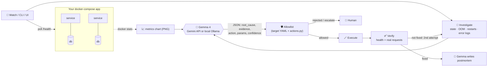

# 🎃 Ghost Hunter

**Open-source AI incident response for docker-compose apps, powered by Gemma 4.**

When a service goes down, the obvious fix is to restart it. That's often wrong. Ghost Hunter
gathers the evidence, has **Gemma 4** find the *real* root cause (which is often a different container
from the one showing symptoms), applies a fix only if it passes an allowlist, verifies recovery with real
requests, and then has Gemma write the postmortem.

It runs on the **Gemini API** or **fully on your machine** with open-weight Gemma 4 through Ollama, so
incident data never has to leave your network.

```
👻 users-service DOWN (ReadTimeout)
🔮 root cause : users-db container has exited, so users-service can't reach its database
🪄 action     : start_container {'name': 'users-db'}   (confidence 1.0, decided in 23s)
🕯  evidence   : users-db state: exited · "java.net.UnknownHostException: users-db"
📈 chart      : users-db memory drops to near zero around -6s, indicating the container has stopped
✨ exorcised  : 3/3 services UP, 3/3 real requests passing (verified in 7.6s)
📜 postmortem : postmortems/<id>-users-service-outage-due-to-users-db-exit.md
```

A fixed "restart whatever is unhealthy" rule would have restarted `users-service`, which doesn't help
because the database is the problem.

## Features

- **Root cause, not symptom.** Gemma 4 reasons over health checks, container state (exit code, OOMKilled,
  restart count, paused), filtered error logs and the service call graph.
- **Multimodal.** A live CPU and memory chart of every container is sent to Gemma 4 as an image, and its
  reading of the chart is part of the evidence.
- **Safe by construction.** The model only *proposes*. Actions are checked against a per-target allowlist
  (which actions, which containers, limits such as max memory) before anything runs. Anything unclear is
  escalated to a human.
- **Verified recovery.** An incident only counts as fixed when health checks *and* real smoke requests
  pass. If not, Gemma gets a second attempt, with what it already tried.
- **🌙 Night watch.** Event-driven autonomous mode. It wakes immediately on Docker events (crash, OOM
  kill, stop, pause, unhealthy), falls back to a 30 s health check for silent failures, confirms a failure
  twice before acting, backs off on failures it can't fix, and ignores false alarms. See
  [Night watch](#night-watch-triggers-and-cost).
- **📜 Gemma-written postmortems.** Blameless Markdown postmortem for every incident (timeline, root
  cause with evidence, resolution, "why not a naive restart?", follow-ups) with the metrics chart attached.
- **Open-weight backend.** Switch to local Gemma 4 (`gemma4:e4b` via Ollama) with one flag.
- **Automatic local fallback.** If the Gemini API errors or times out mid-incident and Ollama is running,
  the same decision is made by local open-weight Gemma 4, and the decision card and postmortem say so.
  If no model is reachable at all, Ghost Hunter escalates to a human instead of acting blind.
- **Agent skill + CLI.** Coding agents can call Ghost Hunter as a tool (see [`skill/ghost-hunter/SKILL.md`](skill/ghost-hunter/SKILL.md)).
- **Reusable harness.** Point it at any docker-compose app with one YAML file; add actions with one decorated function.

## How it works



| File | Role |
|---|---|
| [`core.py`](core.py) | Detect, investigate, verify, fault injection. Driven entirely by the target YAML |
| [`actions.py`](actions.py) | Pluggable action registry: model prompt, validation and execution in one place |
| [`model.py`](model.py) | Gemma 4 client: Gemini API or Ollama, streaming thoughts, image input, deadlines, fallbacks |
| [`agent.py`](agent.py) | The incident loop, audit log, cross-process incident lock |
| [`watch.py`](watch.py) | Night watch: autonomous polling + incident handling |
| [`postmortem.py`](postmortem.py) | Gemma-written postmortems |
| [`metrics.py`](metrics.py) | `docker stats` sampler and chart renderer |
| [`cli.py`](cli.py) / [`ghosthunter`](ghosthunter) | CLI for humans, scripts and coding agents |
| [`app.py`](app.py) | Streamlit UI |
| [`targets/`](targets/) | Target definitions (EcoCycle + a template) |

## Quick start

Requirements: Docker, Python 3.11+, and a Gemini API key **or** Ollama.

```bash
cd ghosthunter
python3 -m venv .venv && .venv/bin/python -m pip install -r requirements.txt
echo "GEMINI_API_KEY=your-key" > .env      # git-ignored

# start the demo app (EcoCycle) from the repo root
(cd .. && DB_PASSWORD=ecocycle docker compose up -d)

./ghosthunter status
.venv/bin/python -m streamlit run app.py   # UI on http://localhost:8501
```

### Run fully local with open-weight Gemma 4

```bash
brew install ollama && ollama serve &      # or see ollama.com for Linux/Windows
ollama pull gemma4:e4b                      # ~9.5 GB
./ghosthunter --backend ollama recover --dry-run
# or set GHOSTHUNTER_MODEL_BACKEND=ollama, or pick it in the UI sidebar
```

## Demo: three ghosts, three different fixes

```bash
./ghosthunter scenarios
./ghosthunter haunt A            # stop users-db
./ghosthunter recover --yes      # diagnose → fix → verify → postmortem
./ghosthunter haunt reset
```

| Ghost | What a naive restart script does | What Gemma 4 chooses |
|---|---|---|
| **A** `users-db` stopped | Restarts `users-service`. Wrong service | `start_container(users-db)` |
| **B** memory limit too low → OOM crash loop | Restarts into the same OOM, forever | `raise_memory_limit(marketplace-service, 512)` |
| **C** `marketplace-service` frozen | Restarts it. Correct this time | `restart_container(marketplace-service)` |

Scenario C matters: Gemma restarts only when restarting is actually right. Both backends get all three
right; see [BENCHMARKS.md](BENCHMARKS.md).

In the UI, turn on **🌙 Night watch**, click a ghost, and don't touch anything else.

## CLI

```
ghosthunter status                       health of every service
ghosthunter diagnose                     root cause + proposed action (changes nothing)
ghosthunter recover --dry-run            diagnose + allowlist check (changes nothing)
ghosthunter recover --yes                diagnose → act → verify → postmortem
ghosthunter watch [--interval 30]        night watch, headless (event-driven)
ghosthunter postmortems [--show N]       read postmortems
ghosthunter haunt A|B|C|reset            demo fault injection
  global: --json  --backend gemini|ollama  --target file.yaml  --chart  --think
```

Exit codes: `0` healthy/recovered, `1` unhealthy/not recovered, `2` action rejected, `3` error.

## Night watch: triggers and cost

| Trigger | How | Cost while healthy |
|---|---|---|
| Docker events for the target's containers: `die`, `oom`, `kill`, `stop`, `pause`, `health_status: unhealthy` | One `docker events` stream, pushed by the daemon | None, it just waits |
| Fallback health check (silent failures: hangs, error responses) | HTTP GET on each health URL | 3 small requests every 30 s |
| Something looks wrong (event seen or a check failed) | Health checks every 3 s for 90 s | Only during incidents |

Ghost Hunter acts after **2 consecutive failed checks**. Gemma 4 is only called once a failure is
confirmed, never while things are healthy. Metrics for the chart are sampled every 15 s while night
watch is on (so the chart has history from before the incident), every 2 s during an incident, and
not at all otherwise. The local model is unloaded after 5 minutes idle (`OLLAMA_KEEP_ALIVE`).

Measured idle over 60 s on the EcoCycle demo (Mac, everything healthy):

| | Health checks / min | `docker stats` calls / min | CPU (Ghost Hunter + child processes) |
|---|---|---|---|
| Before (fixed 5 s polling, 2 s sampling) | 12 | 30 | 1.39 s |
| Now (event-driven) | 2 | 4–5 | 0.90 s, mostly Python start-up |

It does have to keep running to protect the app, like any monitor. Run it headless with
`./ghosthunter watch` (or as a launchd/systemd service) rather than through the UI.

## Use it on your own app

1. `cp targets/_template.yaml targets/myapp.yaml` and fill in services, health URLs, containers (the
   allowlist), call graph, smoke requests and enabled actions.
2. `GHOSTHUNTER_TARGET=targets/myapp.yaml ./ghosthunter status`

### Add a new action

```python
# actions.py
@action("scale_up", {"name": str, "replicas": int}, "the service is overloaded (high CPU, slow responses)")
def _scale_up(p, target, limits):
    return sh("docker", "compose", "up", "-d", "--scale", f"{p['name']}={p['replicas']}")
```

Then enable it in your target YAML under `actions:`. The model prompt, validation and execution all
pick it up from the registry automatically.

## Configuration

| Env var | Default | |
|---|---|---|
| `GEMINI_API_KEY` | | Gemini API key (or put it in `ghosthunter/.env`) |
| `GHOSTHUNTER_MODEL_BACKEND` | `gemini` | `gemini` or `ollama` |
| `GHOSTHUNTER_MODEL` | `gemma-4-26b-a4b-it` | Gemini API model |
| `OLLAMA_MODEL` | `gemma4:e4b` | Local model |
| `OLLAMA_HOST` | `http://localhost:11434` | |
| `OLLAMA_NUM_CTX` | `8192` | Context window for the local model |
| `GHOSTHUNTER_TARGET` | `targets/ecocycle.yaml` | Target definition |
| `GHOSTHUNTER_DEADLINE_S` | `150` | Wall-clock limit per model call |
| `OLLAMA_KEEP_ALIVE` | `5m` | How long the local model stays loaded after a call |
| `GHOSTHUNTER_FALLBACK` | `ollama` | Fall back to local Gemma 4 when the Gemini API fails; `none` to disable |

## Limitations

- Runs against **local docker-compose** only; no Kubernetes or remote hosts yet.
- A **small, fixed action set** (start, restart, raise memory, escalate). Anything else is escalated.
- Demo faults are **injected**. Scenario C uses `docker pause`, which shows up in container state and
  makes the diagnosis easier than a real hang would.
- Gemma 4 thinks for ~1–2k tokens per decision, so a diagnosis takes **~20–45 s**. Fine for incident
  response, too slow for per-request decisions.
- The local `e4b` model reads the metrics chart less reliably than the API model (see benchmarks).

## Roadmap

Slack / PagerDuty notifications and approvals · Kubernetes target · more actions (scale, roll back
image, rotate config) · confidence threshold that asks a human before acting · learning from past
postmortems · screenshot input (paste a Grafana panel).

## Contributing

Ghost Hunter is a Hacktoberfest project and contributions are welcome. See
[CONTRIBUTING.md](CONTRIBUTING.md) and [GOOD_FIRST_ISSUES.md](GOOD_FIRST_ISSUES.md).

---
Built at Hacktoberfest Hack Day Raleigh 2026. The demo app, EcoCycle, existed before the event;
Ghost Hunter was built during it.
